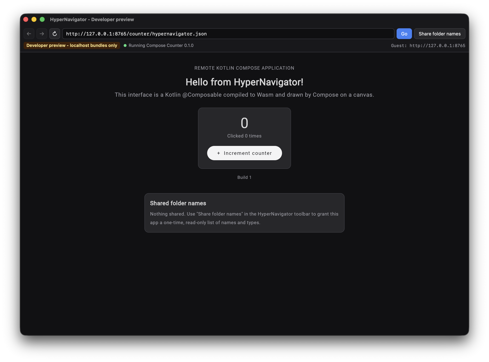

# HyperNavigator

HyperNavigator is a browser-like desktop app for macOS that opens **Kotlin Compose applications
over HTTP**. Instead of HTML pages, it loads apps written with `@Composable` functions, the same
programming model as Android's Jetpack Compose, compiled to WebAssembly and rendered by Compose's
own canvas renderer inside the HyperNavigator window.

> **Developer preview, trusted localhost only.** Version 0.1 loads unsigned, unverified code from
> `http://127.0.0.1:8765` and nowhere else. It is **not** safe for untrusted applications and makes
> no claim of sandboxing remote code against all threats.

<p align="center">
  
</p>
<p align="center"><em>The Compose counter example (Kotlin compiled to Wasm) running in HyperNavigator. The top bar is
HyperNavigator's trusted browser chrome; everything below it is drawn by Compose.</em></p>

## Contents

- [How it works](#how-it-works)
- [Running Jetpack Compose apps compiled to Wasm](#running-jetpack-compose-apps-compiled-to-wasm)
- [Repository layout](#repository-layout)
- [Quick start](#quick-start)
- [Using HyperNavigator](#using-hypernavigator)
- [Security model and limitations](#security-model-and-limitations)
- [Technology and tested versions](#technology-and-tested-versions)
- [Tests](#tests)
- [Further documentation](#further-documentation)

## How it works

```text
 Web server (http://127.0.0.1:8765)              HyperNavigator (one native macOS window)
┌──────────────────────────────┐              ┌───────────────────────────────────────────────┐
│ <app>/hypernavigator.json    │ ─(1) fetch─▶ │ Rust host: validates URL + manifest           │
│ <app>/index.html             │              │                                               │
│ <app>/<app>.js               │              │ ┌───────────────────────────────────────────┐ │
│ <app>/<hash>.wasm  (app)     │              │ │ chrome WebView (trusted, bundled UI)      │ │
│ <app>/<hash>.wasm  (Skia)    │              │ │ address · Go · Back · Forward · Reload    │ │
│ <app>/composeResources/…     │              │ ├───────────────────────────────────────────┤ │
└──────────────────────────────┘ ─(2) load──▶ │ │ guest WebView (the app, no host access)   │ │
                                              │ │ Kotlin/Wasm + ComposeViewport → <canvas>  │ │
                                              │ └───────────────────────────────────────────┘ │
                                              └───────────────────────────────────────────────┘
```

1. You enter the URL of an app's `hypernavigator.json` manifest. The Rust host fetches it and
   validates it: exact origin, size and timeout limits, no redirects, schema version 1,
   `runtime: "compose-wasm-web"`, and a safe relative `entry` page.
2. The host creates a fresh, isolated **guest WebView** (the macOS system WebView, WKWebView) in the
   lower part of the window and points it at the entry page.
3. The page loads the Kotlin/Wasm module. `ComposeViewport` attaches a real Compose UI to a
   `<canvas>`, and state, clicks and recomposition work as they do in any Compose app.
4. The **chrome** (address bar and controls) is a separate, trusted WebView. Only it can call the
   host's commands. The guest has no Tauri, filesystem or shell access.

Because the app is downloaded and compiled at runtime by the WebView, you can rebuild an app and
press **Reload** to see the new version **without rebuilding HyperNavigator**.

## Running Jetpack Compose apps compiled to Wasm

HyperNavigator does not run Android APKs, AARs or DEX code. It runs Compose code that has been
compiled with **Compose Multiplatform** for the **Kotlin/Wasm (`wasmJs`)** target. Compose
Multiplatform uses the same `androidx.compose.*` packages and APIs as Jetpack Compose, so
`@Composable` UI written for Android usually compiles for Wasm unchanged. What changes is the build
setup and the entry point.

The [`notes`](WebAppExamples-src/notes) example is a typical Jetpack Compose screen ported this way:
Material 3, a `ViewModel` with `StateFlow`, `collectAsStateWithLifecycle`, type-safe Navigation
Compose and string/plural resources. HyperNavigator needed no changes to run it.

### 1. Build the app for the `wasmJs` target

Use a Kotlin Multiplatform module with the Compose Multiplatform plugins and put your UI in
`commonMain` (abbreviated from [`notes/build.gradle.kts`](WebAppExamples-src/notes/build.gradle.kts)):

```kotlin
plugins {
    kotlin("multiplatform")
    id("org.jetbrains.compose")
    id("org.jetbrains.kotlin.plugin.compose")
    id("org.jetbrains.kotlin.plugin.serialization")   // only for type-safe navigation routes
}

kotlin {
    @OptIn(ExperimentalWasmDsl::class)
    wasmJs {
        outputModuleName.set("notes")
        browser { commonWebpackConfig { outputFileName = "notes.js" } }
        binaries.executable()
    }
    sourceSets.commonMain.dependencies {
        implementation("org.jetbrains.compose.material3:material3:1.9.0")
        implementation("org.jetbrains.compose.components:components-resources:1.12.1")
        implementation("org.jetbrains.androidx.lifecycle:lifecycle-viewmodel-compose:2.11.0")
        implementation("org.jetbrains.androidx.lifecycle:lifecycle-runtime-compose:2.11.0")
        implementation("org.jetbrains.androidx.navigation:navigation-compose:2.9.2")
    }
}
```

### 2. Replace the Activity with a Wasm entry point

```kotlin
// Android                                      // HyperNavigator (src/wasmJsMain)
class MainActivity : ComponentActivity() {      @OptIn(ExperimentalComposeUiApi::class)
    override fun onCreate(b: Bundle?) {         fun main() {
        super.onCreate(b)                           ComposeViewport(viewportContainerId = "webApp") {
        setContent { NotesApp() }                       NotesApp()
    }                                               }
}                                               }
```

Add an `index.html` (in `src/wasmJsMain/resources/`) with `<div id="webApp"></div>` that loads the
generated `<app>.js`. See [`notes/src/wasmJsMain/resources/index.html`](WebAppExamples-src/notes/src/wasmJsMain/resources/index.html).

### 3. Adjust the few Android-specific pieces

| Jetpack Compose on Android | Compose Multiplatform on Kotlin/Wasm |
|---|---|
| Android Gradle plugin, Google `androidx.*` artifacts | Kotlin Multiplatform `wasmJs` target, JetBrains artifacts with the **same packages** |
| `viewModel()` | `viewModel { MyViewModel() }` (explicit initializer; also valid on Android) |
| `res/values/strings.xml`, `R.string.x`, `androidx.compose.ui.res.stringResource` | `composeResources/values/strings.xml`, `Res.string.x`, `org.jetbrains.compose.resources.stringResource` (same XML format, plurals too) |
| Material icons (`Icons.Default.*`) | add the icons dependency, or use text/vector drawables |

Unchanged: `@Composable` functions, `remember`/`rememberSaveable`, Material 3 components,
`ViewModel` + coroutines/`StateFlow`, `collectAsStateWithLifecycle`, Navigation Compose with
`@Serializable` routes and `toRoute()`.

**Not available** on Kotlin/Wasm in v0.1: `Context`, `Intent`, `Toast`, Android runtime
permissions, `java.io.File`, Room/SQLite, CameraX, Maps Compose, Hilt and other Android-only
libraries. The only host capability is HyperNavigator's user-approved, read-only folder-name listing
(see [Using HyperNavigator](#using-hypernavigator)).

To keep a single codebase, add `androidTarget()` next to `wasmJs` in the same Kotlin Multiplatform
module: the `commonMain` UI is then used unchanged by the Android app and by HyperNavigator.

### 4. Add a manifest

Place `hypernavigator.json` next to `index.html`:

```json
{
  "schemaVersion": 1,
  "id": "dev.hypernavigator.examples.notes",
  "name": "Compose Notes",
  "version": "0.1.0",
  "runtime": "compose-wasm-web",
  "entry": "index.html",
  "permissions": []
}
```

`id` is 1–128 characters of `[A-Za-z0-9._-]`, `name` 1–64 printable characters, `version` semver-like,
`entry` a relative `.html` path inside the app folder, and `permissions` must be empty in v0.1.
Unknown fields are rejected.

### 5. Build, serve and open

From the repository root:

```bash
(cd WebAppExamples-src && ./gradlew :notes:wasmJsBrowserDistribution)
mkdir -p WebServer-dist/notes
cp -R WebAppExamples-src/notes/build/dist/wasmJs/productionExecutable/. WebServer-dist/notes/
cp WebAppExamples-src/notes/hypernavigator.json WebServer-dist/notes/
python3 -m http.server 8765 --bind 127.0.0.1 --directory WebServer-dist
```

Then open `http://127.0.0.1:8765/notes/hypernavigator.json` in HyperNavigator.
`WebAppExamples-src/scripts/build-example.sh` and `serve-example.sh` do this for every example.

The server must send the manifest as `application/json` and `.wasm` files as `application/wasm`
(Python's `http.server` does both), answer `HEAD` for the entry page, and must not redirect.

## Repository layout

| Path | What it is |
|---|---|
| [`HyperNavigator-src/`](HyperNavigator-src/README.md) | **The browser.** Tauri 2 + Rust host (`src-tauri/`) and the trusted TypeScript/Vite browser chrome (`src/`). |
| [`WebAppExamples-src/`](WebAppExamples-src/README.md) | **Apps that run in the browser.** A standalone Gradle project: `counter/` (minimal Compose counter), `notes/` (ported Jetpack Compose screen), broken-manifest `fixtures/`, and build/serve/smoke-test scripts. |
| `WebServer-dist/` | Generated web server root (git-ignored) that `serve-example.sh` publishes on `http://127.0.0.1:8765`. |
| [`PRD.md`](PRD.md) | Product requirements and acceptance criteria (HN-001 … HN-015). |
| [`screenshots/`](screenshots) | Screenshots of the running app. |
| `wireframes/`, `specification/` | Early wireframe and design-session screenshots. |
| [`NOTES.md`](NOTES.md) | Background notes on the original concept (a JVM/JAR approach that the PRD replaced). |

The browser and the examples are independent projects. They meet only over HTTP.

## Quick start

Requirements: macOS on Apple Silicon (tested on macOS 26.7), Xcode command line tools, Rust stable,
Node.js 20.19+ or 22.12+, JDK 17 or newer, Python 3.

```bash
# terminal A: build the example apps and serve them on http://127.0.0.1:8765
cd WebAppExamples-src
scripts/build-example.sh
scripts/serve-example.sh

# terminal B: launch HyperNavigator
cd HyperNavigator-src
npm install            # first time only
npm run tauri:dev
```

The address bar starts with `http://127.0.0.1:8765/counter/hypernavigator.json`. Press **Go**.
Try `http://127.0.0.1:8765/notes/hypernavigator.json` for the ported Jetpack Compose app.

The first Gradle build downloads Gradle, Kotlin, Compose and a Node.js toolchain; the first Rust
build compiles Tauri. Both take a few minutes.

## Using HyperNavigator

- **Go / Back / Forward / Reload.** History is a list of manifest URLs. Back, Forward and Reload
  re-fetch and re-validate the manifest and load the app into a **brand-new guest WebView** with an
  empty, non-persistent data store, so Reload always picks up a rebuilt app (and starts with fresh
  state).
- **Status and origin.** The status bar shows loading, running and error states, the persistent
  "Developer preview – localhost bundles only" badge, and the origin of the app in the guest view.
- **Clear errors.** An offline server, invalid JSON, wrong schema or runtime, a missing or escaping
  entry, a blocked scheme/host/port, or a redirect each produce a specific message. The
  `fixtures/` manifests demonstrate them (`http://127.0.0.1:8765/fixtures/<name>/hypernavigator.json`).
- **Share folder names.** The only capability an app can receive. You pick a folder in the native
  macOS picker; HyperNavigator shows exactly what will be shared (names and types of at most 100
  items directly inside it: no paths, contents, sizes, recursion or write access) and sends it to the
  current app only after you confirm. Symlinks are reported, not followed. The grant ends when the
  app navigates or reloads.
- **Trackpad taps.** HyperNavigator injects a small compatibility script into app pages so macOS
  tap-to-click (which WebKit reports with `buttons = 0`) registers as a press in Compose.

## Security model and limitations

What v0.1 enforces:

- Only `http://127.0.0.1:8765` is accepted, for both the manifest fetch and the guest's own
  navigations. Other schemes, hosts, aliases (`localhost`, `127.1`, IPv6), ports, userinfo,
  percent-encoding and `..` are rejected. Popups and downloads are blocked.
- The guest WebView has **no Tauri permissions**: host commands are declared in `build.rs` and granted
  only to the `chrome` WebView label. This is covered by ACL tests and by a runtime probe that runs
  inside the real guest WebView.
- Folder names reach the app as a JSON string in a one-way event; filenames are never inserted into
  JavaScript source.

What it does **not** provide:

- No signatures, publisher identity or bundle verification: apps are unsigned localhost code.
- No network egress control: an app can still make its own requests (fetch, WebSocket, images).
- Not an OS sandbox. Tauri capabilities restrict Tauri IPC only; WebKit or host bugs could still
  expose the system.
- Tauri's multi-WebView API is marked unstable, and Compose Multiplatform for Web (Kotlin/Wasm) is
  Beta. The WebView must support WebAssembly GC (Safari 18.2+ engine). Only macOS arm64 is tested.

## Technology and tested versions

| Part | Technology | Versions |
|---|---|---|
| Host | Rust + Tauri 2 (`unstable` multi-WebView), wry/WKWebView, ureq, rfd | Rust 1.98.1, Tauri 2.12.3, tauri-build 2.7.2 |
| Browser chrome | TypeScript + Vite, no framework | TypeScript 7.0.2, Vite 8.3.4, `@tauri-apps/api` 2.12.4 |
| Apps | Kotlin Multiplatform `wasmJs` + Compose Multiplatform (`ComposeViewport`) | Kotlin 2.4.20, Compose Multiplatform 1.12.1, Material 3 1.9.0, Lifecycle 2.11.0, Navigation 2.9.2, Gradle 9.7.0, JDK 17 |
| App server (dev) | `python3 -m http.server` | Python 3.14 |

## Tests

```bash
cd HyperNavigator-src
(cd src-tauri && cargo test)     # 46 Rust tests: URL policy, manifest/fetch, history, layout,
                                 # folder listing, JS payload escaping, Tauri ACL (guest denied)
npm test                         # 12 Node tests: capability/CSP/command audits, input shim
npm run build                    # TypeScript check + Vite production build

cd ../WebAppExamples-src
scripts/build-example.sh && scripts/smoke-test.sh    # 53 checks on the served apps and their sources
```

Debug-only runtime security probe: `HN_SECURITY_PROBE=1 npm run tauri:dev`, then load an app. The
host runs a script inside the guest that tries host commands, plugin commands, `file://` access,
popups and off-origin navigation, and prints `[hn-security-probe] …` results (all must be denied).

## Further documentation

- [HyperNavigator-src/README.md](HyperNavigator-src/README.md): browser architecture, manifest rules,
  navigation semantics, troubleshooting.
- [HyperNavigator-src/IMPLEMENTATION_NOTES.md](HyperNavigator-src/IMPLEMENTATION_NOTES.md): design
  decisions, security constraints, tests executed, and the PRD acceptance results.
- [WebAppExamples-src/README.md](WebAppExamples-src/README.md): building, serving and adding example
  apps, and the full Jetpack Compose porting notes.
- [PRD.md](PRD.md): product requirements and roadmap.
